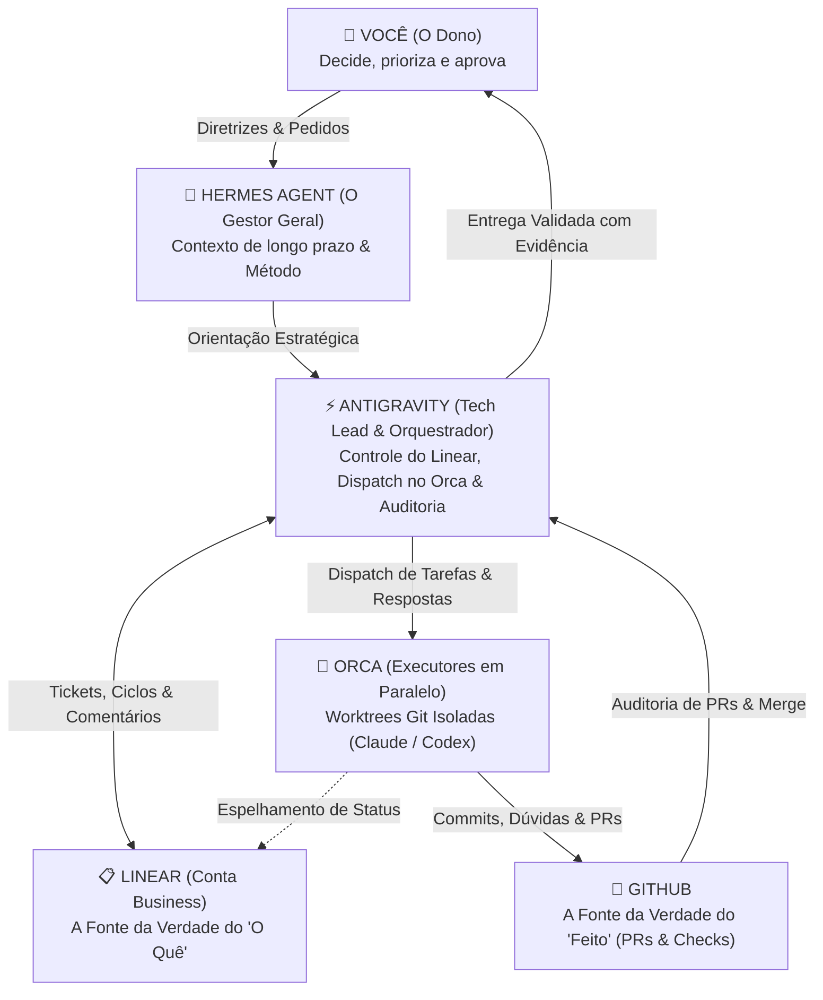

# 🚀 STACK DE AGENTES PRO: ANTIGRAVITY + LINEAR BUSINESS + ORCA + HERMES

Este repositório contém a infraestrutura completa de um **Time de Desenvolvimento Autônomo com Múltiplos Agentes de IA**, baseado na arquitetura avançada de **Gabriel Kendy** (apresentada no vídeo [I Built a FULL DEV TEAM with AI](https://www.youtube.com/watch?v=_TUd87JKTa0&t=581s)), **com a substituição do Cursor pelo Antigravity** e integração total com o **Linear (Conta Business)**.

---

## 🏗️ ARQUITETURA DO TIME



---

## ⚡ POR QUE ANTIGRAVITY NO LUGAR DO CURSOR?

| Funcionalidade | Cursor tradicional | Antigravity (Nesta Stack) |
| :--- | :--- | :--- |
| **Execução de Ferramentas** | Apenas chat e terminal passivo | **Ferramentas Nativas** (`run_command`, `view_file`, etc.) |
| **Subagentes Concorrentes** | Manual (abrir 4 janelas) | **Nativo** (`invoke_subagent` em segundo plano) |
| **Protocolo de Orquestração** | Depende de colar prompts na janela | **Integrado** via `GEMINI.md` e regras automáticas |
| **Integração MCP** | Configuração limitada no app | **Servidor MCP nativo do Linear** no `mcp_config.json` |
| **Automação de Respostas** | Humano precisa copiar e colar | **Scripts de desbloqueio automático** (`linear_manager.py`) |

---

## 📋 CONFIGURAÇÃO DO LINEAR (CONTA BUSINESS)

A Conta Business do Linear permite que a stack opere sem as limitações do plano gratuito:
- **Projetos e Equipes ilimitados**
- **Sub-issues e dependências avançadas**
- **Ciclos automatizados (Sprints) e SLAs**
- **Acesso à API GraphQL e Personal API Keys sem expiração de sessão**

### Como Obter e Configurar sua Chave do Linear:
1. Acesse sua conta Linear: [https://linear.app/settings/api](https://linear.app/settings/api)
2. Vá em **Personal API Keys** e clique em **Create Key**.
3. Dê o nome `Stack-Agentes-Antigravity` e copie a chave gerada (começa com `lin_api_...`).
4. Abra o arquivo `d:\Stack de Agentes\.env` e cole sua chave:
   ```env
   LINEAR_API_KEY=lin_api_sua_chave_aqui
   LINEAR_TEAM_KEY=ENG
   LINEAR_PROJECT_NAME=MeuProjeto
   ```
5. Valide a conexão executando:
   ```bash
   python linear_manager.py verify
   ```

---

## 🛠️ ARQUIVOS E FERRAMENTAS INCLUÍDAS

- **`setup_stack.py`:** Diagnóstico automático em 1 clique de toda a stack (GitHub, Orca, Hermes, Linear e Antigravity).
- **`linear_manager.py`:** CLI e módulo de integração direta com o Linear GraphQL (cria projetos, issues, posta comentários de desbloqueio e altera status).
- **`orca_bridge.py`:** Ponte com o Orca ADE (dispara worktrees isoladas vinculadas às tarefas do Linear e checa dúvidas).
- **`orchestrator_monitor.py`:** Painel de auditoria das **4 Janelas** (Worktrees locais, arquivos `.orchestrator-question`, PRs no GitHub e tickets no Linear).
- **`AGENTS.md`:** Protocolo de Orquestração que rege o comportamento de todos os agentes.
- **`GEMINI.md`:** Regras do Tech Lead Orquestrador Antigravity.
- **`CLAUDE.md`:** Regras dos agentes executores que rodam no Orca.
- **`PROMPTS.md`:** Os 4 Prompts Mestres prontos para uso.
- **`docs/PLANO_TEMPLATE.md`:** Template do método de Fatias Verticais (Fase 0 até Fase N).

---

## 🔄 O FLUXO DE EXECUÇÃO NA PRÁTICA

1. **A Ideia vira Plano:**
   Cole o **Prompt 1 (As Fases)** no Hermes ou no Antigravity. Ele devolve o plano em Fatias Verticais e cria o `docs/PLANO.md`.
2. **Criação dos Tickets no Linear:**
   O Antigravity cria as issues no Linear com os critérios de aceite de cada fase.
3. **Dispatch da Tarefa no Orca:**
   O Antigravity dispara a execução:
   ```bash
   python orca_bridge.py dispatch --slug feat-fase1 --issue ENG-1 --prompt "Implementar Fase 1"
   ```
4. **Comunicação Bidirecional e Desbloqueio:**
   - Se o executor tiver dúvidas, ele cria `.orchestrator-question` e comenta no ticket.
   - O monitor do Antigravity detecta e responde imediatamente no ticket via `linear_manager.py comment`.
5. **Revisão nas 4 Janelas:**
   O Antigravity audita o código no disco, inspeciona o Pull Request no GitHub e valida os testes reais.
6. **Aprovação e Avanço:**
   Com a fase 100% verde, o status é movido para **Done** no Linear e a próxima fase é iniciada automaticamente.
